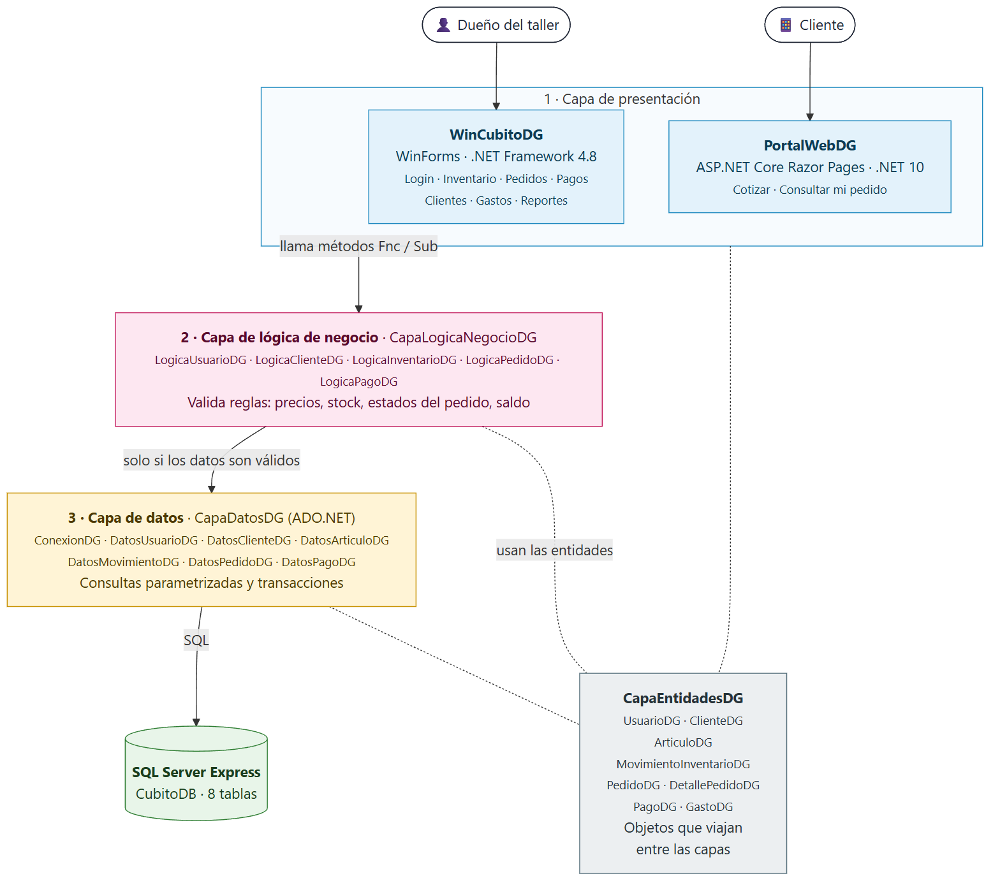
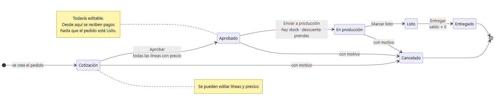

# Cubito

Sistema de gestión de pedidos, inventario y finanzas para el taller de serigrafía, sublimación y DTF **Cubito**.
Proyecto final de Programación 2 · **Grupo 9**.

| Integrante | Carné | Área |
|---|---|---|
| Danilo Giron | 0900-20-1087 | Base de datos y lógica |
| Elias Israel Canel Ramirez | 0900-25-7066 | Portal web y UI/UX |
| Luis Pedro Johaido Ramírez Letona | 0900-23-22881 | Formularios y pruebas |
| José David Moreno Najarro | 0900-25-17340 | Reportes y documentación |

Plan completo: [docs/PLAN.md](docs/PLAN.md). Entrega: sábado 24 de octubre de 2026.

## Estructura

```text
CubitoDG.sln
sql/
  01-CrearBaseDG.sql        Crea la base CubitoDB y sus 8 tablas
  02-DatosInicialesDG.sql   Usuario admin y algunos registros de ejemplo
  03-DatosPruebaDG.sql      Datos de prueba: clientes, artículos, pedidos, pagos y gastos (opcional)
src/
  CapaEntidadesDG/          Clases de datos (ClienteDG, PedidoDG, ...)
  CapaDatosDG/              Acceso a SQL Server con consultas parametrizadas
  CapaLogicaNegocioDG/      Reglas y validaciones del negocio
  WinCubitoDG/              Aplicación de escritorio (Windows Forms, .NET Framework 4.8)
  PortalWebDG/              Base del portal web para clientes (siguiente etapa, no forma parte de esta entrega)
docs/
  PLAN.md                   Plan de ejecución
  DEMO.md                   Guion de la demostración (ensayo y defensa)
  diagramas/                Diagramas (.mmd editable + .png para el informe)
```

Las tres capas usan **.NET Standard 2.0**, así un portal web futuro podrá usar exactamente las mismas reglas que el escritorio.

```text
WinCubitoDG ──> CapaLogicaNegocioDG ──> CapaDatosDG ──> SQL Server Express (CubitoDB)
CapaEntidadesDG: la usan todas las capas
```

El detalle está en la sección [Diagramas](#diagramas).

## Requisitos para trabajar

1. **Visual Studio 2022 o superior** con las cargas de trabajo *Desarrollo de escritorio de .NET* y *ASP.NET y desarrollo web*.
2. **.NET Framework 4.8** (viene con Windows 10/11). Para el escritorio sirve cualquier SDK de .NET 8 o más nuevo (el que trae Visual Studio). Solo el portal necesita el **SDK de .NET 10**.
3. **SQL Server Express** y **SQL Server Management Studio (SSMS)**.
4. **Git**.

## Primera vez: instalar y ejecutar

### 1. Clonar

```bash
git clone https://github.com/Darturo9/CubitoGrupo9.git
```

### 2. Crear la base de datos

Abre SSMS, conéctate a tu instancia de SQL Express y ejecuta **en este orden** (abrir el archivo y presionar F5):

1. `sql/01-CrearBaseDG.sql`
2. `sql/02-DatosInicialesDG.sql`
3. `sql/03-DatosPruebaDG.sql` *(opcional)*: pedidos en todos los estados, pagos y movimientos de inventario para probar y para la demostración. Las fechas se calculan desde el día en que se ejecuta.

Para volver a empezar, ejecute otra vez los scripts en el mismo orden: `01` borra y crea las tablas.

Se puede volver a ejecutar cuando quieras empezar de cero: borra y vuelve a crear las tablas.

### 3. Configurar la conexión (solo si tu instancia no se llama `SQLEXPRESS`)

Por defecto el sistema se conecta a `.\SQLEXPRESS`. Si tu instancia tiene otro nombre (por ejemplo `SQLEXPRESS01`), **no cambies** `App.config` ni `appsettings.json`, porque afectarías a tus compañeros. Crea una variable de entorno para tu usuario en PowerShell:

```powershell
setx CUBITO_SQL_DG "Server=.\SQLEXPRESS01;Database=CubitoDB;Integrated Security=True;TrustServerCertificate=True"
```

Cierra y vuelve a abrir Visual Studio para que tome el cambio.

### 4. Ejecutar

- **Escritorio:** en Visual Studio, clic derecho en `WinCubitoDG` → *Establecer como proyecto de inicio* → F5.
  Usuario de demostración: `admin`, contraseña: `Cubito2026`.

## Cómo agregar un módulo

Todos los módulos siguen el mismo patrón; `Clientes` sirve de ejemplo:

1. **Entidad** en `CapaEntidadesDG` (ya existen las 8).
2. **Datos** en `CapaDatosDG`: una clase `Datos<Modulo>` con consultas parametrizadas (ver `DatosClienteDG.cs`). Nunca concatenar texto del usuario en el SQL.
3. **Lógica** en `CapaLogicaNegocioDG`: una clase `Logica<Modulo>` que valida y luego llama a datos (ver `LogicaClienteDG.cs`).
4. **Formulario** en `WinCubitoDG`. El formulario solo llama a la lógica: **nada de SQL en los formularios**.
5. En `frmPrincipalDG.cs`, el botón del menú abre el formulario con `SubAbrirDG(new frmModuloDG())`.
6. **Diseño:** en el constructor del formulario, después de `InitializeComponent()`, aplica el tema para que se vea igual que el resto:

   ```csharp
   InitializeComponent();
   TemaDG.SubAplicarTemaDG(this);                                                // colores, botones y grillas
   TemaDG.SubBotonDG(btnGuardarXX, EstiloBotonDG.Primario, IconoDG.GuardarDG);  // acción principal en magenta
   TemaDG.SubBotonDG(btnEliminarXX, EstiloBotonDG.Peligro, IconoDG.EliminarDG); // acción destructiva en rojo
   ```

   Solo un botón **Primario** por pantalla (la acción más común). Los íconos disponibles están en `IconoDG` (`TemaDG.cs`); son de la fuente Segoe Fluent Icons que trae Windows, no hay que descargar nada.

## Estándares de código

Se siguen los estándares del curso:

| Elemento | Regla | Ejemplo |
|---|---|---|
| Variables | `[alcance][tipo][nombre][iniciales]` | `lStrNombreClienteDG`, `pIntIdPedidoDG`, `gObjLogicaDG` |
| Alcance | `l` local, `g` global, `p` parámetro | |
| Tipo | `Str`, `Int`, `Dbl`, `Dcm` (decimal), `Dtm` (fecha), `Bln`, `Obj`, `Lst` (lista), `Arr` | |
| Funciones (devuelven valor) | Prefijo `Fnc` | `FncCalcularTotalDG` |
| Métodos (no devuelven valor) | Prefijo `Sub` | `SubGuardarPedidoDG` |
| Clases, formularios, proyectos | Terminan en las iniciales | `PedidoDG`, `frmPedidosDG` |
| Controles | `frm`, `txt`, `lbl`, `gpb`, `btn`, `dgv`, `cmb`, `dtp`, `nud`, `pnl` (panel), `tar` (tarjeta), `mar` (logo) | `txtNombreDG`, `dgvPedidosDG` |

Cada integrante usa **sus propias iniciales** en el código que escribe (pendiente de confirmar con el ingeniero).
Montos siempre en `decimal`, nunca en `double`.

## Forma de trabajo con Git

1. Antes de empezar, actualiza tu rama con lo último de `main`:

   ```bash
   git checkout main
   git pull
   git checkout feature/<tu-rama>
   git merge main
   ```

2. Trabaja **solo** en la rama de tu módulo:

   | Rama | Responsable | Issue |
   |---|---|---|
   | `feature/clientes` | Luis | #7 |
   | `feature/gastos` | Luis | #11 |
   | `feature/reportes` | José David | #14 |
   | `feature/datos-prueba` | José David | #8 |
   | `feature/portal-web` | Elias | #10, #13 |

3. Haz commits pequeños con mensajes claros, por ejemplo `Agregar formulario de gastos con validaciones`.
4. Sube tu rama (`git push`) y abre un **Pull Request** hacia `main`. GitHub llena el PR con una lista de verificación: revísala antes de pedir revisión.
5. En el PR aparece la revisión automática **Compilar**: GitHub compila toda la solución. Si sale ❌, abre el detalle, corrige y vuelve a subir; el PR se actualiza solo.
6. Danilo revisa el PR, lo prueba con `sql/03-DatosPruebaDG.sql` y lo une a `main`.

**Fecha límite para PRs: 21/10.** El 22/10 se integra todo y desde ese día solo se aceptan correcciones.

**Terminado significa:** compila sin errores, cumple los estándares, las validaciones funcionan, se probó con datos y está documentado.

## Base de datos

| Tabla | Para qué sirve |
|---|---|
| UsuariosDG | Login del dueño (contraseña guardada como hash SHA-256) |
| ClientesDG | Clientes del taller |
| ArticulosDG | Prendas e insumos con stock, mínimo y máximo |
| MovimientosInventarioDG | Kardex: entradas, salidas y ajustes |
| PedidosDG | Pedidos; el código `CUB-0001` se genera solo |
| DetallePedidosDG | Líneas del pedido; el subtotal se calcula solo |
| PagosDG | Pagos y anticipos |
| GastosDG | Gastos del taller |

Estados del pedido: `Cotización → Aprobado → En producción → Listo → Entregado`, o `Cancelado` (con motivo).

Pagos: se registran desde que el pedido está `Aprobado` hasta `Listo`. Saldo = Total − pagos; ningún pago puede pasar del saldo y el pedido solo se entrega con saldo 0.

## Diagramas

Están en `docs/diagramas/`. Cada uno tiene su archivo `.mmd` (texto en [Mermaid](https://mermaid.js.org), fácil de editar) y su `.png` listo para el informe.

| # | Diagrama | Qué muestra |
|---|---|---|
| 1 | [Arquitectura por capas](docs/diagramas/01-arquitectura.png) | Presentación → lógica → datos → SQL Server, y las entidades que comparten |
| 2 | [Clases: entidades](docs/diagramas/02-clases-entidades.png) | Las 8 clases de `CapaEntidadesDG`, sus propiedades y relaciones |
| 3 | [Clases: lógica y datos](docs/diagramas/03-clases-logica-datos.png) | Métodos de cada clase `Logica*` y `Datos*` y quién usa a quién |
| 4 | [Flujo de datos](docs/diagramas/04-flujo-datos.png) | Procesos del sistema, qué datos entran y salen y en qué tablas se guardan |
| 5 | [Modelo entidad-relación](docs/diagramas/05-modelo-er.png) | Las 8 tablas con llaves y reglas (CHECK) |
| 6 | [Estados del pedido](docs/diagramas/06-estados-pedido.png) | Cotización → Entregado, con la condición de cada paso |

### Arquitectura por capas



### Estados del pedido



### Volver a generar las imágenes

Si cambian las clases o las tablas, edite el `.mmd` y genere de nuevo el `.png` (necesita Node.js y Google Chrome):

```bash
npm install -g @mermaid-js/mermaid-cli@11.4.2
mmdc -i docs/diagramas/01-arquitectura.mmd -o docs/diagramas/01-arquitectura.png -b white -s 2
```

También se puede pegar el contenido del `.mmd` en [mermaid.live](https://mermaid.live) y descargar la imagen.
